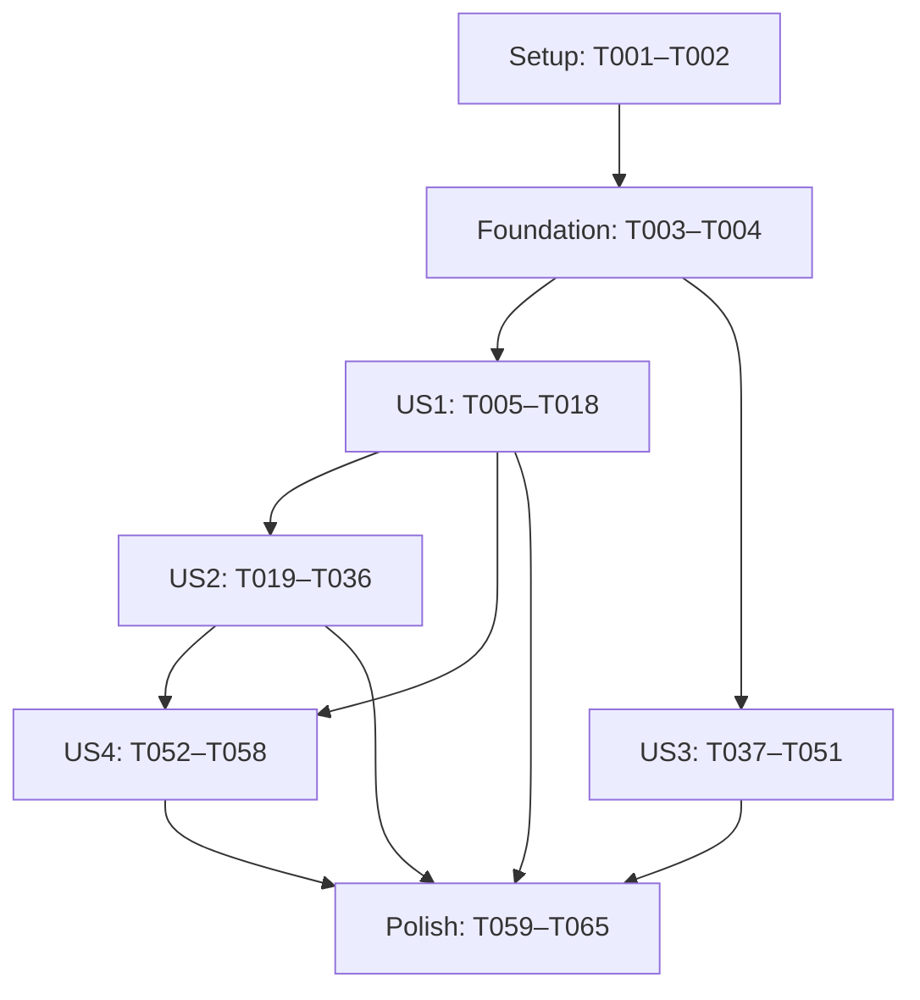

# Tasks: Vistoria ampliada e rota de transporte do Guincho

**Input**: `specs/031-guincho-vistoria-rota/` — [spec](spec.md), [plan](plan.md), [research](research.md), [data-model](data-model.md), [contrato de fotos](contracts/inspection-api.md), [UI](contracts/inspection-ui.md), [rota](contracts/guincho-route-api.md) e [quickstart](quickstart.md).

**Branch real**: `feature/refinamento-guincho`. Identificador lógico: `031-guincho-vistoria-rota`. Nenhum checkout ou criação de branch é necessário.

**Tests**: Não criar suítes automatizadas, mocks, fixtures ou TDD. A constituição exige solicitação explícita, ausente nesta feature. As tarefas de validação abaixo executam build/lint/análise e cenários **manuais** do quickstart; não são tarefas para gerar código de teste.

**Organization**: Quatro histórias, em ordem P1/P1/P1/P2. Marcadores refletem a execução registrada no quickstart; validações funcionais e medições ainda pendentes não são consideradas aprovadas pelos checks locais.

## Formato e caminhos

`- [ ] Tnnn [P?] [USn?] Ação com arquivo concreto`.

- Caminhos são relativos à raiz do repositório. Arquivo ainda inexistente é saída de implementação, não placeholder a criar vazio.
- [P] permite o paralelismo **somente nos grupos explicitados adiante**, após seus pré-requisitos; não permite executar uma fase inteira simultaneamente.
- Alterações repetidas no mesmo arquivo são sequenciais. O preparador/contratos v2 da US1 são reutilizados pela fila durável da US2; não criar um segundo pipeline temporário.
- Migrations novas têm nomes concretos abaixo. Conferir colisões em T002 antes de criá-las; se necessário avançar timestamps mantendo a ordem e atualizar as referências deste documento. Não editar migrations já aplicadas.
- Reutilizar Kotlin/Compose/MVVM, injeção manual, coroutines, Coil, ExifInterface, MapLibre e Supabase instalados. Sem novas dependências, módulos, Room, WorkManager ou serviço permanente de upload.

## Phase 1: Setup — contexto e ambiente

**Objetivo**: Preservar a base existente e identificar condições reais para executar as mudanças.

- [X] T001 Registrar branch real, arquivos já modificados e hashes de referência; preservar as melhorias de GPS presentes, sem checkout/reset, registrando o estado inicial em `specs/031-guincho-vistoria-rota/quickstart.md`.
- [X] T002 Conferir Java/SDK/Gradle, Deno, ADB e CLI exclusivamente via npx supabase; inventariar migrations/funções e nomes de secrets do Dev e do alvo Homol/Prod compartilhado, identificar roteador e contas autorizadas sem registrar valores confidenciais; documentar bloqueios reais em `specs/031-guincho-vistoria-rota/quickstart.md`.

## Phase 2: Foundational — baseline e integrações compartilhadas

**Objetivo**: Confirmar os serviços existentes dos quais as histórias dependem, sem recriar autenticação, tracking ou infraestrutura.

- [X] T003 Executar baseline de assembleDevDebug, assembleHomolDebug, assembleProdDebug, lintHomolDebug e validateEnvironmentIsolation conforme guia; registrar resultados e distinguir falhas preexistentes das alterações futuras em `specs/031-guincho-vistoria-rota/quickstart.md`, `app/build.gradle.kts`.
- [X] T004 Conferir os pontos existentes de autorização/guards de vistoria, início manual, sessão/conectividade e posição publicada; registrar referências efetivas de integração, preservando captured_at de now()-30 s a now()+10 s e a separação de PitTec, sem criar infraestrutura genérica em `specs/031-guincho-vistoria-rota/research.md`, `specs/031-guincho-vistoria-rota/contracts/inspection-api.md`, `specs/031-guincho-vistoria-rota/contracts/guincho-route-api.md`.

**Checkpoint**: Baseline e integração conhecidos. Problemas de acesso/configuração devem ser registrados; não confundir indisponibilidade externa com sucesso. Implementação local independente pode progredir, mas nenhuma tarefa de aplicação/validação bloqueada deve ser marcada como concluída.

## Phase 3: User Story 1 — Documentar os pontos sem ampliar o mínimo (P1) — MVP funcional

**Goal**: Oferecer 17 pontos, quatro obrigatórios, 13 opcionais e detalhes livres, persistindo o conjunto compatível com leitores antigos.

**Independent validation**: Em Dev, abrir após Cheguei, enviar só FRONT/REAR/LEFT/RIGHT, conferir cliente/histórico; deixar um principal ausente com opcionais preenchidas e verificar bloqueio. Cada opcional nomeada ocupa um ponto; detalhes livres coexistem. Conferir leitores v1 e originais/miniaturas v2.

- [X] T005 [US1] Criar migration aditiva com detail_point anulável nas fotos/manifesto, thumbnail_object_path/byte_size, constraints do catálogo e unicidade separada de reserva/seleção de opcionais nomeados; manter índices principais e múltiplos DETAIL nulos, sem backfill nem alteração das oito migrations aplicadas em `supabase/migrations/20261014140000_guincho_inspection_catalog_assets.sql`.
- [X] T006 [US1] Ampliar guards de imutabilidade e igualdade anulável da categoria no manifesto; preservar categoria/seleção na cópia para correção e nas operações discard/unselect; conservar a categoria ao substituir foto nomeada por prepare v1, sem tocar versões fechadas em `supabase/migrations/20261014141000_guincho_inspection_catalog_guards.sql`, `supabase/migrations/20261014152000_guincho_inspection_legacy_projection.sql`.
- [X] T007 [US1] Criar get_guincho_inspection_v2/list_guincho_inspection_photos_v2 com categoria/miniatura e named_photos limitado a 17 selecionadas, autorização, paginação e cursores existentes; manter shape/enum das projeções v1 e contagem explícita FRONT/REAR/LEFT/RIGHT de 0/4 em `supabase/migrations/20261014142000_guincho_inspection_reads_v2.sql`, `supabase/migrations/20261014153000_guincho_inspection_named_snapshot.sql`.
- [X] T008 [US1] Implementar prepare/confirm v2 com replay autorizado antes de revision/editabilidade, comparação de intenção congelada, paths server-side e promoção atômica dos dois assets/seleção; reforçar confirm/submit v1 segundo asset_mode da linha e bloquear toda reserva ativa, incluindo opcionais/substituições em `supabase/migrations/20261014143000_guincho_inspection_commands_v2.sql`.
- [X] T009 [US1] Ampliar helpers/RLS de leitura e INSERT para exclusivamente os paths original/thumb reservados; verificar owner/MIME/tamanho, autor/versão DRAFT e suporte autorizado; manter bucket privado, negações anon/UPDATE/DELETE/upsert e ausência de escrita direta em tabelas em `supabase/migrations/20261014144000_guincho_inspection_thumbnail_storage.sql`.
- [X] T010 [P] [US1] Modelar catálogo estável de quatro principais e 13 categorias DETAIL opcionais do data-model, identidade por ponto/foto, asset_mode e metadados de thumb; manter enum point legado e detalhes livres múltiplos, aceitando categoria desconhecida como detalhe não obrigatório na leitura em `app/src/main/java/com/trustarx/pitgo/features/guincho/model/GuinchoInspectionModels.kt`.
- [X] T011 [US1] Ampliar DTOs/mapeamentos e validação de documentos, páginas e envelopes v2 para categoria e variantes, sem alterar os códigos serializados legados nem aceitar paths/metadados inválidos em `app/src/main/java/com/trustarx/pitgo/features/guincho/data/GuinchoInspectionDtos.kt`.
- [X] T012 [P] [US1] Preparar original e thumb em arquivos distintos do raw, fora da Main Thread, com bounds/amostragem e oito orientações EXIF; limitar original a 2560 px/5 MiB e thumb a 480 px/256 KiB, usando temporários, validação e rename, sem recomprimir derivados reservados em `app/src/main/java/com/trustarx/pitgo/features/guincho/data/GuinchoInspectionCaptureFiles.kt`.
- [X] T013 [US1] Integrar leitura/preparação/confirm v2 e envio dos dois arquivos sem upsert, preservando seleção anterior até READY e expondo erro recuperável de backend incompatível; conservar original-only para reserva v1 existente, sem fallback de novas capturas v2 para v1 em `app/src/main/java/com/trustarx/pitgo/features/guincho/repository/GuinchoInspectionRepository.kt`.
- [X] T014 [US1] Construir quadros por ponto efetivo, progresso obrigatório separado e coleção de detalhes livres; passar categoria na captura/substituição e impedir submissão sem quatro READY ou com qualquer inclusão/substituição pendente, mantendo regras de edição existentes em `app/src/main/java/com/trustarx/pitgo/features/guincho/viewmodel/GuinchoInspectionViewModel.kt`.
- [X] T015 [US1] Renderizar grade lazy de 17 mini quadros em ordem estável, principais em destaque, rótulos obrigatório/opcional, preview e ações de captura/ampliação/substituição; preservar entrada após Cheguei e coleção livre de avarias em `app/src/main/java/com/trustarx/pitgo/features/guincho/ui/GuinchoInspectionScreen.kt`.
- [X] T016 [P] [US1] Adicionar nomes pt-BR dos 17 pontos, progresso 0/4 e mensagens/descrições de acessibilidade de obrigatoriedade e estado, seguindo os tokens visuais existentes em `app/src/main/res/values/strings.xml`.
- [X] T017 [US1] Revisar grants/policies e ordem das migrations de fotos, incluindo as correções aditivas de projeção e snapshot nomeado, executar npx supabase db push --dry-run no Dev correto e conferir todo o conjunto pendente, inclusive de outras histórias; aplicar sequencialmente ao projeto somente quando arquivos/dependências/guards/permissões estiverem completos e revisados, aguardando migrations incompletas; disponibilizar backend v2 e depois compilar/instalar APK Dev atualizado no aparelho autorizado, registrando versões/evidências sem secrets em `specs/031-guincho-vistoria-rota/quickstart.md`, `supabase/migrations/20261014144000_guincho_inspection_thumbnail_storage.sql`.
- [ ] T018 [US1] Validar manualmente catálogo 4+13, quatro principais sem opcionais, principal faltante mesmo com opcionais, múltiplos detalhes e substituição única; conferir conjunto enviado/histórico e leitor v1, registrando SC-001 e parcela de SC-007/008 em `specs/031-guincho-vistoria-rota/quickstart.md`.

**Checkpoint**: Catálogo e contrato v2 utilizáveis no fluxo existente, sem alterar enum legado ou mínimo obrigatório. A robustez de retomada/rotação é entregue pela US2; este MVP é um incremento de demonstração, não a entrega completa solicitada.

## Phase 4: User Story 2 — Fotografar e salvar sem perder a etapa (P1)

**Goal**: Retornar imediatamente ao álbum, salvar por foto com estado durável, suportar rotação/interrupção e retomar automaticamente pela mesma conta ao reabrir ou recuperar conexão.

**Independent validation**: Capturar vertical/horizontal, girar durante retorno/envio, fotografar outro ponto enquanto salva e interromper cada etapa. Reabrir primeiro fora do álbum, inclusive sem rede, e reconectar: retomar automaticamente sem duplicar. Substituição falha preserva anterior; sessão/versão incorreta bloqueia com explicação.

- [X] T019 [US2] Adicionar identidade/intenção durável, operações UUID, hashes locais congelados, etapa retomável e estados AWAITING_CAMERA até SAVED/RETRY_WAIT/NEEDS_RECAPTURE/BLOCKED_CONTEXT/DISCARDED, separados da câmera e da operação de documento em `app/src/main/java/com/trustarx/pitgo/features/guincho/model/GuinchoInspectionModels.kt`.
- [X] T020 [US2] Criar PendingStore com journal AtomicFile no filesDir por ambiente/conta/atendimento/capture_id, Mutex e geração; persistir intenção antes do launch e RAW_CAPTURED/captured_at uma única vez; reconciliar arquivos/commits interrompidos e preservar raw até derivados concluídos em `app/src/main/java/com/trustarx/pitgo/features/guincho/data/GuinchoInspectionPendingStore.kt`.
- [X] T021 [US2] Integrar o preparador da US1 à árvore durável, com um normalizador, cancelamento cooperativo, sync/rename antes do avanço de journal e prévia imutável; impor fila 512 MiB/reserva livre 64 MiB sem evictar aceitas e importar legado apenas com conta/intenção comprováveis em `app/src/main/java/com/trustarx/pitgo/features/guincho/data/GuinchoInspectionCaptureFiles.kt`.
- [X] T022 [P] [US2] Restringir FileProvider à área privada de captura e conceder apenas URI raw solicitada; excluir árvore de pendências de backup e device transfer, preservando demais regras existentes em `app/src/main/res/xml/guincho_inspection_file_paths.xml`, `app/src/main/res/xml/backup_rules.xml`, `app/src/main/res/xml/data_extraction_rules.xml`.
- [X] T023 [US2] Implementar runner no Repository atual com uma fila de mutação/envio por atendimento e estados observáveis por captura; reservar IDs duráveis e salvar resposta da reserva antes de upload, sem depender de Job da tela nem bloquear poll de documento em `app/src/main/java/com/trustarx/pitgo/features/guincho/repository/GuinchoInspectionRepository.kt`.
- [X] T024 [US2] Reconciliar resultado remoto antes de exigir arquivo/editabilidade, reconhecendo READY e replay mesmo após avanço da versão; manter IDs/payload em REVISION_CONFLICT; distinguir duplicidade estruturada 400/409 e comparar hash dos bytes remotos em resultado incerto, sem afirmar todo 400 como sucesso em `app/src/main/java/com/trustarx/pitgo/features/guincho/repository/GuinchoInspectionRepository.kt`.
- [X] T025 [US2] Classificar falhas e retentativas retomáveis por etapa; resolver reserva remota antes de descarte explícito e manter foto anterior na substituição; bloquear contexto encerrado/versão selada por outra sessão sem anexar à nova versão ou abrir correção automaticamente em `app/src/main/java/com/trustarx/pitgo/features/guincho/repository/GuinchoInspectionRepository.kt`.
- [X] T026 [US2] Revalidar conta/geração antes/depois de suspensões e dentro do commitMutex; invalidar/cancelar no logout ou troca de ambiente, limpar somente apresentação/cache de leitura em IO e preservar journals/arquivos de capturas aceitas não confirmadas, privados por conta/ambiente; retomar só pela mesma conta no mesmo ambiente após revalidar permissões; remover pendências só após salvamento confirmado ou descarte explícito permitido, impedir commits de Jobs antigos e pausar em sessão expirada em `app/src/main/java/com/trustarx/pitgo/features/guincho/repository/GuinchoInspectionRepository.kt`, `app/src/main/java/com/trustarx/pitgo/features/guincho/data/GuinchoInspectionPendingStore.kt`.
- [X] T027 [US2] Criar SyncViewModel da feature para ativar a fila da conta inteira por sessão válida, visibilidade e conectividade, inclusive ao reabrir fora do álbum; respeitar lifecycle, sem Activity retida, GlobalScope ou requisito de upload com app encerrado em `app/src/main/java/com/trustarx/pitgo/features/guincho/viewmodel/GuinchoInspectionSyncViewModel.kt`.
- [X] T028 [US2] Injetar PendingStore e dependências de sessão/conectividade no Repository e factory do SyncViewModel com o container existente, preservando as melhorias de localização e sem nova biblioteca/camada em `app/src/main/java/com/trustarx/pitgo/core/app/PitGoAppContainer.kt`.
- [X] T029 [US2] Vincular SyncViewModel à raiz autenticada e emitir eventos de sessão/foreground/rede para retomada automática da conta, mesmo no mapa inicial; liberar owner ao sair do contexto e manter UI sem acesso direto ao Repository nem regra de fotos no SessionViewModel em `app/src/main/java/com/trustarx/pitgo/core/navigation/PitGoNavHost.kt`.
- [X] T030 [US2] Substituir captura/upload global por estado individual vindo da fila; manter só capture_id/estado pequeno no SavedStateHandle, devolver álbum com raw ao callback aceito e tratar repetição/cancelamento sem duplicar, apagar aceita ou modificar etapa; antes de T036, integrar eventos monotônicos/trace de callback, ação, primeiro frame da miniatura/original/feedback e confirmação de salvamento, sem PII, conforme método do quickstart em `app/src/main/java/com/trustarx/pitgo/features/guincho/viewmodel/GuinchoInspectionViewModel.kt`, `app/src/main/java/com/trustarx/pitgo/features/guincho/ui/GuinchoInspectionScreen.kt`.
- [X] T031 [US2] Registrar TakePicture estável em toda recriação, após journal persistido, e nunca relançar automaticamente; tratar AWAITING_CAMERA sem resultado restaurável como captura interrompida recuperável; solicitar portrait só na vistoria e restaurar orientação anterior, com conteúdo vertical responsivo em >=600dp/multiwindow em `app/src/main/java/com/trustarx/pitgo/features/guincho/ui/GuinchoInspectionScreen.kt`.
- [X] T032 [US2] Separar downloads thumb/original por conta/ambiente/photo_id/variante, promover .part validado por rename e limitar cache de leitura a 128 MiB; usar snapshot autorizado por conjunto em vez de RPC por foto, máximo dois downloads com prioridade interativa e invalidação por sessão em `app/src/main/java/com/trustarx/pitgo/features/guincho/repository/GuinchoInspectionRepository.kt`, `app/src/main/java/com/trustarx/pitgo/features/guincho/data/GuinchoInspectionCaptureFiles.kt`.
- [X] T033 [US2] Fazer merge monotônico por versão/revisão e IDs mantendo arquivos, estados e tarefas inalterados; separar loading/erro de cada variante e câmera exclusiva de operações de documento; impedir submissão por captura apenas local, sem reiniciar todos os downloads a cada atualização em `app/src/main/java/com/trustarx/pitgo/features/guincho/viewmodel/GuinchoInspectionViewModel.kt`.
- [X] T034 [US2] Exibir Preparando/Salvando/Salva/Falha individualmente com retry/recaptura/retirada explícita e foto anterior na substituição; permitir rolar, ampliar e capturar outro ponto durante envio, com Coil dimensionado por constraints e chaves imutáveis em `app/src/main/java/com/trustarx/pitgo/features/guincho/ui/GuinchoInspectionScreen.kt`.
- [X] T035 [US2] Adicionar mensagens acionáveis de sessão, arquivo ausente, captura interrompida, falta de espaço, contexto encerrado e pendência, com anúncio acessível sem repetir a grade nem expor caminhos/códigos técnicos em `app/src/main/res/values/strings.xml`.
- [ ] T036 [US2] Compilar/instalar APK Dev atualizado e executar cenários manuais de captura/rotação/recriação, interrupção/retry, reabertura fora do álbum, reconexão e versão selada por outra sessão; capturar offline, sair, entrar em outra conta sem acesso à pendência e voltar à original para retomada sem recaptura; medir SC-002/003/004/005/009 com instrumentação T030 e amostras do guia, registrando proporção dentro da meta/p95 e limitações reais em `specs/031-guincho-vistoria-rota/quickstart.md`.

**Checkpoint**: Capturas aceitas disponíveis permanecem recuperáveis; miniatura não significa salvamento compartilhado. Falha isolada não bloqueia navegação, e todo item local pendente protege a submissão.

## Phase 5: User Story 3 — Mostrar percurso ao iniciar transporte (P1)

**Goal**: Após início manual confirmado, mostrar percurso viário ao destino contratado e recalcular automaticamente em desvio confirmado, preservando etapa em falhas.

**Independent validation**: Pode usar vistoria aprovada da feature 030, sem depender de novos pontos. Aprovação sem início não ativa percurso. Início confirmado abre rota mesmo com fix já conhecido; desvio preciso recalcula, oscilação não. Retomada mantém destino; concorrência e resposta após encerramento não publicam rota inválida.

- [X] T037 [US3] Criar tabela guincho_route_snapshots por atendimento, constraints de geometria/origem completos, route_version e lease_context separado da rota confirmada; habilitar RLS sem leitura/DML direto anon/authenticated e RPC de leitura autorizado por participante/etapa, inclusive referência sem GPS fresco em `supabase/migrations/20261014145000_guincho_route_snapshot.sql`.
- [X] T038 [US3] Implementar claim service-role com usuário verificado, GUINCHO_DIRECT/IN_PROGRESS/início e guards existentes; obter posição/destino autoritativos, congelar lease_context, lease 10 s/intervalo 5 s, reuso por origem <=50 m e verificação PostGIS de desvio, respeitando qualidade/idade e sem cache cego de 15 s em `supabase/migrations/20261014150000_guincho_route_refresh.sql`.
- [X] T039 [US3] Implementar finish/fail service-role com commit atômico, lease válido, etapa/destino/ordem (published_at,version), backoff 5/10/20/30 s e preservação da rota anterior; instalar cleanup ao sair de IN_PROGRESS para invalidar lease e impedir publicação tardia, sem rejeitar todo fix mais novo durante HTTP em `supabase/migrations/20261014151000_guincho_route_finish_cleanup.sql`.
- [X] T040 [P] [US3] Criar Snapshot/State/reason da rota com route_version, origem, destino, geometria compartilhada e falha com referência/retryAt; implementar cálculo de distância aos segmentos com longitude normalizada e detector de três fixes distintos em >=4 s, idade <=10 s, precisão <=35 m e limiar max(50 m,2×precisão) em `app/src/main/java/com/trustarx/pitgo/features/guincho/model/GuinchoRouteModels.kt`.
- [X] T041 [US3] Criar DTOs do body fechado e respostas 200/202/falhas, validando atendimento/destino, limites geográficos, pares finitos exatos, 2..10000 pontos, distância <=2000000 m e route_version, sem confundir revisão de GPS com versão de rota em `app/src/main/java/com/trustarx/pitgo/features/guincho/data/GuinchoRouteDtos.kt`.
- [X] T042 [US3] Criar handler autenticado com auth.getUser antes de cache/service-role, aceitando só appointment_id/reason/known_route_version; usar claim e OSRM configurado com GeoJSON/full sem steps/alternatives, timeout total 4 s e corpo upstream <=1 MiB antes de parse; chamar finish/fail e mapear HTTP/retry metadata sem expor URLs/JWT/coordenadas em `supabase/functions/guincho-route/index.ts`.
- [X] T043 [US3] Registrar guincho-route com verify_jwt=true e reutilizar somente os nomes de secrets backend existentes, mantendo intactas as configurações/contratos de pittec-route e guincho-quote em `supabase/config.toml`.
- [X] T044 [US3] Criar Repository para snapshot e endpoint com uma chamada em voo por conta/ambiente/atendimento, confluência da posição mais recente, geração e route_version monotônicos; respeitar 202/429/backoff, terminar seguidores/deferred e liberar dono em finally não cancelável ao cancelar, sem polling upstream por fix em `app/src/main/java/com/trustarx/pitgo/features/guincho/repository/GuinchoRouteRepository.kt`.
- [X] T045 [US3] Adicionar estado de percurso específico ao tracking do guincheiro sem substituir estados de GPS ou PitTec; prover geometria/erro/retry e polilinha memoizada por route_version em `app/src/main/java/com/trustarx/pitgo/features/appointmenttracking/model/AppointmentTrackingModels.kt`.
- [X] T046 [US3] Integrar Repository no container/factory e ativar primeira rota após startTransport confirmado ou etapa confirmada no poll/retomada, inclusive com mesmo fix conhecido; ao reabrir ler snapshot e RESUME; cancelar requests/retries em onHidden/fim/sessão sem desfazer transporte e descartar contexto antigo; antes de T051, integrar eventos monotônicos/trace de início/desvio confirmado até primeiro frame do percurso, incluindo espera por admissão e sem PII, conforme quickstart em `app/src/main/java/com/trustarx/pitgo/core/app/PitGoAppContainer.kt`, `app/src/main/java/com/trustarx/pitgo/core/navigation/PitGoNavHost.kt`, `app/src/main/java/com/trustarx/pitgo/features/appointmenttracking/viewmodel/AppointmentTrackingViewModel.kt`, `app/src/main/java/com/trustarx/pitgo/features/guincho/ui/GuinchoTrackingContent.kt`, `app/src/main/java/com/trustarx/pitgo/core/map/ui/MapLibreMapHost.kt`.
- [X] T047 [US3] Alimentar detector de desvio com fixes válidos e cálculo fora da Main Thread, resetando série em baixa qualidade/regresso; recalcular automaticamente só em desvio confirmado, conflar última posição e reavaliar após resposta, mantendo marcador independente e destino imutável em `app/src/main/java/com/trustarx/pitgo/features/appointmenttracking/viewmodel/AppointmentTrackingViewModel.kt`.
- [X] T048 [US3] Passar polilinha própria apenas ao mapa do guincheiro em transporte e mostrar loading/recalculando/falha com última referência; enquadrar destino/rota em mudança sem recentrar pickup ou contrariar gesto; sem ligação direta falsa, preservando tracking do cliente e apresentação PitTec em `app/src/main/java/com/trustarx/pitgo/features/guincho/ui/GuinchoTrackingContent.kt`, `app/src/main/java/com/trustarx/pitgo/features/appointmenttracking/ui/AppointmentTrackingScreen.kt`, `app/src/main/res/values/strings.xml`.
- [X] T049 [P] [US3] Evitar reaplicar GeoJSON de rota quando só marcador mudou, comparando geometria/estilo e resetando memória ao instalar estilo; preservar fallback e comportamento de PitTec em `app/src/main/java/com/trustarx/pitgo/core/map/ui/ParticipantMapStyleController.kt`.
- [ ] T050 [US3] Executar Deno check, revisar grants/RLS/claims e todo o conjunto de migrations pendentes mostrado no dry-run, inclusive de outras histórias; aguardar arquivos/dependências/guards/permissões completos e revisados e serializar aplicação ao projeto Dev via npx supabase; disponibilizar Edge Function autenticada e depois compilar/instalar APK Dev atualizado; confirmar função/configuração/roteador com smoke autenticado e registrar evidências em `specs/031-guincho-vistoria-rota/quickstart.md`, `supabase/functions/guincho-route/index.ts`.
- [ ] T051 [US3] Validar manualmente aprovação sem início, início recusado/confirmado, mesmo fix, retomada/destino, desvios reais e GPS impreciso, falha upstream, leases concorrentes e encerramento em voo; usar instrumentação T046 para medir 20 inícios/20 desvios incluindo cooldown até renderização, registrar proporção dentro da meta/p95 e SC-006/008, sem chamadas a cada fix ou starvation em `specs/031-guincho-vistoria-rota/quickstart.md`.

**Checkpoint**: Rota específica do transporte funcionando no guincheiro, sem alterar cotação, pagamentos, origem/destino contratados ou PitTec. Atualização do GPS não dispara upstream por fix.

## Phase 6: User Story 4 — Revisar conjunto e preservar histórico (P2)

**Goal**: Cliente recebe categorias e fotos corretas, revisa originais, retorna à transação após aprovação e consulta histórico sem exigir fotos retroativas.

**Independent validation**: Revisar quatro principais com opcionais e detalhe livre; falha de original mantém aprovação bloqueada mesmo com thumb. Recuperar, aprovar e voltar à mesma transação. Consultar versão antiga como ambos os participantes e trocar versão durante ampliação sem misturar conjuntos.

- [X] T052 [US4] Representar prontidão de revisão por original de cada foto/versão enviada, independente de thumb, com bloqueio de aprovação por indisponibilidade e invalidação quando imagem/versão/permissão mudar em `app/src/main/java/com/trustarx/pitgo/features/guincho/model/GuinchoInspectionModels.kt`.
- [X] T053 [US4] Integrar pré-carga/validação limitada de originais à agenda de downloads existente, dando prioridade à abertura explícita e preservando sucesso por ID/variante; cancelar contexto indevido sem reutilizar cache de outra conta em `app/src/main/java/com/trustarx/pitgo/features/guincho/repository/GuinchoInspectionRepository.kt`.
- [X] T054 [US4] Habilitar aprovação somente com todo conjunto vigente salvo e originais apresentados/validados; manter demais fotos utilizáveis em falha e preservar a imagem aberta durante atualização, impedindo decisão sobre versão antiga sem exigir opcionais ausentes em `app/src/main/java/com/trustarx/pitgo/features/guincho/viewmodel/GuinchoInspectionViewModel.kt`.
- [X] T055 [US4] Mostrar categorias/legendas, thumbs, ampliação e progresso de preparação da revisão/histórico com falhas individuais; manter fallback original-only e rótulo genérico para categoria desconhecida sem exigir captura retroativa em `app/src/main/java/com/trustarx/pitgo/features/guincho/ui/GuinchoInspectionScreen.kt`, `app/src/main/res/values/strings.xml`.
- [X] T056 [P] [US4] Preservar retorno após aprovação confirmada à mesma transação com back stack correto e início manual posterior pelo guincheiro; conferir retomada da navegação sem duplicar decisão em `app/src/main/java/com/trustarx/pitgo/core/navigation/PitGoNavHost.kt`.
- [X] T057 [US4] Conferir listagem paginada de versões e fotos antigas/nova correção preservando metadados, decisões e manifesto original; ajustar apenas leitura necessária sem recategorizar registros READY ou alterar versões enviadas em `app/src/main/java/com/trustarx/pitgo/features/guincho/repository/GuinchoInspectionRepository.kt`, `app/src/main/java/com/trustarx/pitgo/features/guincho/viewmodel/GuinchoInspectionViewModel.kt`.
- [ ] T058 [US4] Compilar/instalar APK Dev atualizado e validar manualmente conjunto 4+opcionais, falha de original com thumb válida, recuperação, troca de versão durante consulta, aprovação/retorno e histórico antigo pelos dois participantes; medir 20 sincronizações <=10 s conforme SC-007 e confirmar SC-008/009 em `specs/031-guincho-vistoria-rota/quickstart.md`.

**Checkpoint**: Aprovação depende dos originais do conjunto vigente e não inicia transporte. Versões/decisões antigas continuam legíveis e imutáveis.

## Phase 7: Polish — segurança, qualidade e entrega

**Objetivo**: Verificar a integração completa e disponibilizar somente após evidências suficientes, dentro da autorização vigente para o ambiente.

- [ ] T059 Executar revisão/manual de RLS, originais/thumbs, RPCs v1/v2, usuário alheio, sem sessão, upsert/UPDATE/DELETE e leitura de rota antes da autorização; conferir sessão/cleanup e logs sem PII, registrando resultados reais dos cenários do guia em `specs/031-guincho-vistoria-rota/quickstart.md`, `specs/031-guincho-vistoria-rota/contracts/inspection-api.md`, `specs/031-guincho-vistoria-rota/contracts/guincho-route-api.md`.
- [ ] T060 Conferir TalkBack, labels/textos de estado, toque >=48 dp, fonte ampliada, contraste/temas e orientação em telefone/landscape/multiwindow/>=600dp; corrigir somente problemas da feature em `app/src/main/java/com/trustarx/pitgo/features/guincho/ui/GuinchoInspectionScreen.kt`, `app/src/main/java/com/trustarx/pitgo/features/guincho/ui/GuinchoTrackingContent.kt`, `app/src/main/res/values/strings.xml`.
- [ ] T061 Revisar instrumentação já integrada em T030/T046 e resultados de desempenho; ajustar métricas proporcionais de etapa/variante/latência, cache/lease e erros sem imagens, paths, placas, nomes, coordenadas ou credenciais; conferir memória, threads e ausência de recomposição/reload completo por marcador/revisão; repetir somente medições afetadas por correções em `app/src/main/java/com/trustarx/pitgo/features/guincho/repository/GuinchoInspectionRepository.kt`, `app/src/main/java/com/trustarx/pitgo/features/guincho/repository/GuinchoRouteRepository.kt`, `supabase/functions/guincho-route/index.ts`.
- [X] T062 Executar builds Dev/Homol/Prod, lintHomolDebug, validateEnvironmentIsolation, Deno check e git diff --check; corrigir erros introduzidos, registrar warnings prévios e confirmar ausência de testes/mocks/fixtures/dependências não solicitados em `app/build.gradle.kts`, `supabase/functions/guincho-route/index.ts`, `specs/031-guincho-vistoria-rota/quickstart.md`.
- [ ] T063 Conferir regressão manual da cotação Guincho, PitTec/renderer, GPS atualizado, Cheguei, correção, início, conclusão e cancelamento via fluxos autorizados de Dev, sem SQL fabricando pagamentos/aprovações nem cobranças reais em `specs/031-guincho-vistoria-rota/quickstart.md`.
- [ ] T064 Consolidar amostras/p95 e resultado individual de SC-001–009 com aparelho/Android/ambiente/projeto/APK/SHA-256; distinguir checks locais, execução funcional e cenários bloqueados/não executados; não marcar sucesso só pelo build em `specs/031-guincho-vistoria-rota/quickstart.md`.
- [ ] T065 Dentro da autorização de entrega vigente, repetir inventário/dry-run no alvo Homol/Prod compartilhado, revisar todo o conjunto pendente inclusive de outras histórias e aguardar arquivos/dependências/guards/permissões completos; aplicar migrations sequencialmente ao projeto/deploy via npx supabase antes de instalar APK Homol nos devices autorizados; conferir hashes, smoke e compatibilidade v1, registrando limitações e correção aditiva sem downgrade destrutivo em `specs/031-guincho-vistoria-rota/quickstart.md`, `supabase/config.toml`.

**Checkpoint final**: Não encerrar com cenários obrigatórios não executados tratados como aprovados. Se acesso/aparelhos/roteador impedirem validação, registrar o impedimento e manter tarefas correspondentes pendentes. Não criar cobrança real para satisfazer o roteiro.

## Dependências e ordem de execução

### Grafo de histórias

A sequência padrão é T001 → T065. US3 é independente das ampliações de fotos: o fluxo 030 já fornece aprovação/início/destino. Pode antecipar backend/modelos próprios de US3 após Foundation. Integrações em container/NavHost/strings e a revisão do renderer devem ser serializadas com qualquer trabalho nas mesmas áreas. US4 depende das variantes/cache da US2, mas não da rota US3. Não alegar independência total onde há dependência de código compartilhado.

T017/T050/T065 compartilham um gate de aplicação: revisar todas as migrations pendentes no dry-run do checkout/projeto, não apenas as da história em validação. Se houver migration incompleta de outra história, aguardar sua conclusão/revisão antes de aplicar. Não remover arquivos, pular dependências ou tratar [P] como permissão para aplicações concorrentes ao mesmo projeto. O desenvolvimento local independente continua permitido.

### Pré-requisitos internos

| Grupo | Ordem / condição |
| --- | --- |
| Catálogo SQL | T005 → T006 → T007 → T008 → T009; gates de confirm/submit e compatibilidade v1 são obrigatórios antes de disponibilizar backend |
| Catálogo Android | T010 → T011; T012 usa catálogo/contrato conhecido e não aguarda DTO; T013 exige T007–T012; T014 → T015 e T016 concluídas antes do checkpoint |
| Dev fotos | T017 somente após revisão T005–T009 e APK Dev compatível T010–T016; T018 depende de T017 e duas contas autorizadas |
| Durabilidade | T019 → T020 → T021; T022 pode ocorrer junto, antes da primeira captura com árvore nova; T023 usa T020/T021; T024 → T025 → T026 completam reconciliação/segurança |
| Retomada na raiz | T027 depende do runner T023–T026; T028 → T029 conecta sessão/rede; T030 usa fila já exposta; T031 integra câmera persistida |
| Leitura por foto | T032 → T033 → T034; T035 finaliza mensagens; T036 depende de toda US2, backend de fotos e instrumentação T030 disponível |
| Rota SQL/HTTP | T037 → T038 → T039; T042 usa esse contrato e T043; concluir configuração antes de disponibilização T050 |
| Rota Android | T040 → T041 → T044 → T045 → T046 → T047 → T048; T044 usa contrato backend concluído localmente, sem exigir deploy prévio; T049 preserva interface existente do renderer |
| Dev rota | T050 exige SQL/Edge e build Dev compatível, função/roteador operantes e gate de todas as migrations pendentes; T051 depende de T050, integração Android e instrumentação T046 concluídas |
| Revisão | T052 → T053 → T054 → T055; T056 pode ocorrer em paralelo; T057 → T058 confirmam histórico e fluxo integrado |
| Encerramento | T059–T061 após histórias; T061 revisa instrumentação já disponível, não a inicia; T062 após últimas correções; T063/T064 após checks; T065 somente com validação Dev suficiente, gate de migrations e autorização de entrega aplicável |

T042/T043 são tarefas sequenciais na execução padrão, mas o contrato necessário à escrita do handler está definido antecipadamente. Não exigir a função já publicada para implementar seus consumidores. Aplicar em Dev para validação não autoriza automaticamente uma publicação nova em Homol/Prod; usar o escopo de entrega vigente.

### Paralelismo seguro por história

| História | Exemplo de grupo | Pré-requisitos / junção |
| --- | --- | --- |
| US1 | T005–T009 (SQL) em paralelo com T010 (modelo) e T016 (strings) | Foundation concluída; contratos lidos; arquivos distintos. Após T010, T011 (DTO) e T012 (preparador) podem andar juntos. Juntar tudo em T013 |
| US2 | T019–T021 (journal/arquivos) em paralelo com T022 (XML) | US1 concluída e estrutura privada do data-model conhecida. Concluir XML antes de usar captura durável |
| US3 | T037–T039 (SQL) em paralelo com T040 (modelo/detector) e T049 (renderer) | Foundation concluída; respeitar contrato existente e evitar outro editor no renderer. T041 segue T040; unir endpoint/repository na integração |
| US4 | T052–T055 (revisão) em paralelo com T056 (navegação) | US1/US2 concluídas; NavHost sem edição concorrente de US3. Juntar antes de T058 |

Esses exemplos descrevem oportunidades de execução, não uma instrução para criar agentes ou executar tarefas nesta etapa.

## Estratégia de implementação

1. Concluir Setup/Foundation e preservar o trabalho de GPS já presente.
2. Entregar US1 como MVP de catálogo/contrato v2, com demonstração manual independente; manter as aprovações existentes protegidas. Não considerar a feature completa só por esse incremento.
3. Concluir US2 reutilizando os derivados/contratos da US1, até a retomada funcionar fora do álbum. US1+US2 são o primeiro incremento que cobre o problema relatado de captura e salvamento.
4. Implementar US3 independentemente sobre o transporte existente; integrar com cuidado os arquivos compartilhados e validar recálculo real.
5. Concluir US4 para toda a revisão/histórico e executar a integração completa. Todos os quatro conjuntos são necessários para atender a solicitação.
6. Executar segurança, acessibilidade, checks e medições. Backend revisado é disponibilizado antes de APK novo; Dev antecede eventual Homol/Prod. Correções são aditivas, sem apagar evidências ou afrouxar gates.
7. Marcar tarefa concluída somente quando o arquivo e sua integração existirem e a validação aplicável tiver resultado real. Agrupar commits lógicos conforme a constituição, dentro da autorização vigente; a geração deste documento não cria commit.

## Cobertura e critérios de conclusão

| Requisitos / critérios | Tarefas principais |
| --- | --- |
| FR-001–004, SC-001: catálogo, quatro obrigatórios, identidade e detalhes livres | T005–T016, T018 |
| FR-005–009, SC-002/003/004: retorno, orientação, concorrência e estado por foto | T012, T019–T023, T030–T036 |
| FR-010–014, SC-005: durabilidade, replays, substituição e submissão | T006, T008–T009, T020–T029, T033, T036 |
| FR-015–018, SC-007/008/009: conjunto, permissão, leitura, decisão e legado | T007–T009, T013, T024–T026, T032–T036, T052–T059 |
| FR-019–024, SC-006/008: início, rota, retomada, desvio e falha | T037–T051 |
| FR-025: retorno do cliente à mesma transação e consulta posterior | T054–T058 |
| FR-026: preservar chegada, pagamento, aprovação, início, cancelamento e confirmação final sem resultados fictícios | T004, T008, T024–T026, T039, T046, T051, T054–T058, T063 |
| Segurança/performance transversais do plano e SCs | T009, T022, T026, T032, T042–T049, T059–T064 |

Critérios completos e condições de referência permanecem na [spec](spec.md); medir p95 e proporções sem converter todas as metas em 100%. Segurança, unicidade e integridade exigem o comportamento exato descrito. A matriz não substitui o roteiro manual.

**Resumo**: 65 tarefas — Setup 2; Foundation 2; US1 14; US2 18; US3 15; US4 7; Polish 7. Sete tarefas marcadas [P], com grupos e pré-requisitos explícitos. Consultar os marcadores e as evidências do quickstart para o estado atual de execução.
